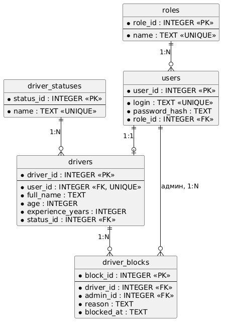

# Регистр учёта такси

## О проекте

Проект представляет собой информационную систему для ведения учета таксистов в компании. Программа предназначена для хранения, просмотра и управления информацией о водителях.

## В системе предусмотрено два типа пользователей

Водитель — может войти в систему под своей учетной записью и работать со своей информацией.

Администратор — имеет расширенные права и может управлять информацией о таксистах: добавлять, просматривать, изменять и удалять данные.

Разделение пользователей по ролям позволяет ограничить доступ к функциям системы. Водитель получает доступ только к необходимым ему возможностям, а администратор может управлять общей информацией о таксистах.

Основная задача проекта — автоматизировать процесс учета водителей и сделать работу с информацией более удобной и организованной.

## Цель работы

Целью работы является разработка информационной системы для учета таксистов компании, позволяющей автоматизировать хранение и обработку информации о водителях.

В результате разработки должна получиться программа, которая позволяет компании эффективно вести учет таксистов и управлять информацией о водителях.

## Функционал проекта٩(｡•́‿•̀｡)۶ 

Основные функции системы:

- учёт водителей;
- учёт автомобилей;
- добавление информации;
- изменение информации;
- удаление информации;
- просмотр информации;
- поиск необходимых данных.

## Диаграмма функционала

Для описания функционала проекта используется язык **PlantUML**.

Диаграмма показывает основные функции системы и взаимодействие пользователей с системой.

## Структура проекта

| Папка/файл | Назначение |
|---|---|
| `src` | Исходный код программы |
| `src/main.py` | Основная программа |
| `docs/diagrams` | Диаграммы PlantUML |
| `README.md` | Описание проекта |

## Используемые технологии٩(◕‿◕｡)۶ 

- Python
- Visual Studio Code
- Git
- GitHub
- Markdown
- PlantUML
## Что нужно для запуска
- Git
- Visual Studio Code (с расширением python)
- Хорошее настроение

## Установка и запуск

### 1. Клонирование репозитория с GitHub

```bash
git clone https://github.com/ignatkorotaev2019-tech/gitExample.git
```

### 2. Переход в корень проекта

```bash
cd gitExample/Lab2
```

### 3. Создание виртуального окружения

**Windows:**

```text
python -m venv venv
```

**Linux/macOS:**

```bash
python3 -m venv venv
```

### 4. Активация виртуального окружения

**Windows (PowerShell):**

```text
.\venv\Scripts\Activate.ps1
```

**Linux/macOS:**

```bash
source venv/bin/activate
```
### 5. Запуск программы

**Windows:**

```powershell
python src/main.py
```

**Linux/macOS:**

```bash
python3 src/main.py
```
#Проектирование базы данных

## ER-диаграмма



## Описание таблиц

| Таблица | Назначение |
|---|---|
| roles | Роли пользователей (Водитель, Администратор) |
| users | Учётные записи: логин, хеш пароля, роль |
| driver_statuses | Статусы водителей (Активен, Заблокирован, На проверке) |
| drivers | Данные водителя: ФИО, возраст, стаж, статус |
| driver_blocks | Блокировки водителей администраторами |

## Связи

- roles → users: 1:N
- users → drivers: 1:1
- driver_statuses → drivers: 1:N
- drivers → driver_blocks: 1:N
- users (администратор) → driver_blocks: 1:N

## База данных

СУБД: SQLite. Файлы в `Lab2/database/`:
- `shema.sql`: создание таблиц (CREATE TABLE) и тестовые данные (INSERT INTO)
- `taxi.db`: готовая база
